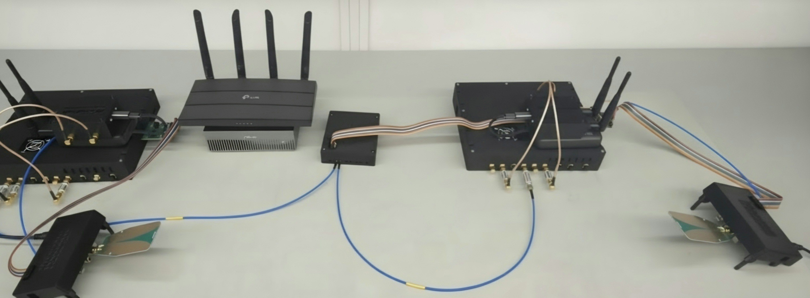
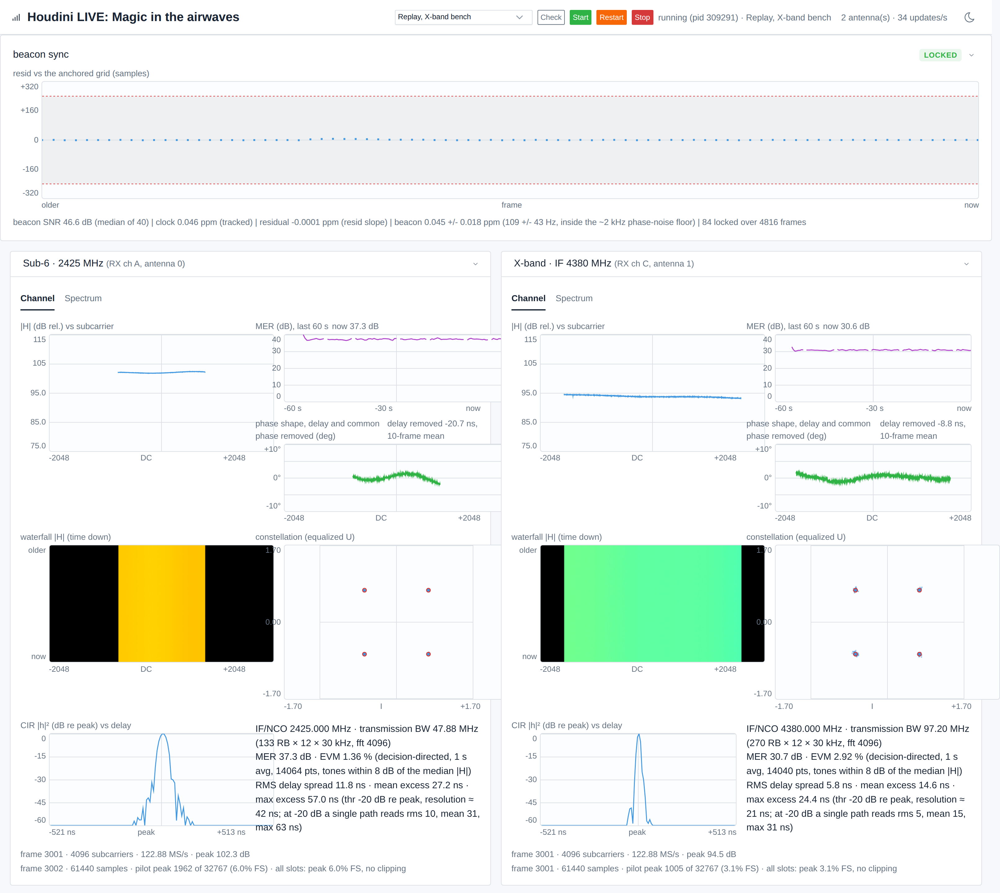

# Running the live CSI dashboard demo, step by step

This walkthrough goes from an empty machine to a live channel display in a web
browser: install the dependencies, build the sounder, point it at your own two
radios, run the base station and client together, and read the panels the
dashboard draws. Every step shows the exact command and what you should see.

If you are on the lab bench, `DEMO_BENCH_RUNBOOK.md` next to this file fills
in every placeholder below with the exact machines, paths, and commands the
live demo runs with. This walkthrough stays generic so it works on any bench.

Five placeholders appear throughout. Add your own values:

- `<bs-ip>`: the address of the radio node you will run as the base station
  (the RFSoC running the Houdini server).
- `<ue-ip>`: the address of the radio node you will run as the client (UE).
- `<host>`: the machine that runs the sounder and the dashboard. It needs
  network reach to both radios. This is normally your compute host, not a
  radio.
- `<path-to-HoudiniLab>`: wherever you cloned this repository on `<host>`.
- `<your-houdini-venv>`: the virtual environment prefix with SoapySDR and its
  Python bindings (and the Houdini host plugin, unless the plugin has a prefix
  of its own, `<host-plugin-prefix>`, section 2.4).

Additional reference material lives in `../../docs/archive/UE_TX_FINE_GRID_TIMING.md`
(why the client pilot lands on the fine timing grid) and
`../../docs/archive/TWO_BOARD_CLOCK_LOCK.md` (locking both boards to one external
reference clock). The record of every measurement behind this walkthrough is
`DEMO_VERIFICATION.md`.

## How this walkthrough is organized

This file is the run path, one level of detail: what to do, in order. Three
companions hold the depth: `DASHBOARD_GUIDE.md` (what each panel shows),
`SOUNDER_REFERENCE.md` (every option and knob) and `TROUBLESHOOTING.md`
(each failure and its fix). Section 1 is the big picture and has no commands: why the demo exists, what
happens in a run, what the system is made of and what the software does.
Sections 2 to 9 are the run itself, in the order you do it, and each ends
with something you can check. Section 0 is the whole run on one screen for a
host that is already set up. On a new bench take the sections in order; on a
known bench section 0 is enough.

| Section | What you do | What you have when it is done |
|---|---|---|
| 0 | The quick start: five commands for a provisioned host | A live page, if the bench and host are known |
| 1 | Read: why two bands, what happens in a run, the system, the software path | The picture of what you are about to build |
| 2 | Install the packages, SoapySDR and the plugin, build the sounder, point it at your two radios | `check_setup.py` prints `Ready.` |
| 3 | Choose a config, climbing the ladder from one band to both at the demo numerology | A config that matches your bench |
| 4 | Run: the dashboard launches the sounder, or you run both yourself; the page's controls; record and replay | The sounder running and the page connected |
| 5 | Read the page; the panel-by-panel guide is `DASHBOARD_GUIDE.md` | You can tell a healthy run from a sick one by looking |
| 6 | Confirm it is real: the log lines and checks of a good run | Evidence behind the numbers |
| 7 | Tune, if the run asks for it; the option tables are `SOUNDER_REFERENCE.md` | A run adjusted to your bench |
| 8 | When something goes wrong: the symptom index; the fixes are `TROUBLESHOOTING.md` | A way out of each known failure |
| 9 | Clean up: stop, release the radios, confirm nothing is left | A bench ready for the next run |
| 10 | The stack and results of the latest full run | What "it works" last meant |

How long it takes. On a known bench, section 0 is about five minutes: the
setup check takes up to a minute per radio, the sounder finds the beacon
within seconds of starting (3 seconds in the latest full run; freshly booted
nodes add about half a minute of retried radio opens), and the clock steering
brings the MER to its final figures about three minutes after a cold start.
On a new bench, from a host with nothing installed, plan on half a day to a
day: the install (section 2) is an hour or two of it on a host with network
access, and the rest is the RF, climbing the config ladder (section 3) one
rung at a time while levels, cabling and antennas are sorted out; the X-band
chain's own bring-up comes before any of it and is not part of this
walkthrough. That range is our own bench history, not a timed measurement.

Within the first minute of a good run the sync card reads `LOCKED`, each
receive antenna's card fills with a steady channel and four tight
constellation clusters, and the MER settles near the figures in section 10;
`DASHBOARD_GUIDE.md` section 1's pictures show what that looks like.

## 0. Quick start

If `<host>` already has the sounder built and the SoapyHoudiniSDR host plugin
installed (section 2 if not), these steps take you from a shell to a live
display. Every command runs on `<host>` unless it says otherwise.

1. Activate the plugin's environment and go to the sounder:

   ```sh
   source <your-houdini-venv>/bin/activate
   cd <path-to-HoudiniLab>/CC/Sounder
   ```

   Steps 3 and 4 name the host plugin built with the radios' release:
   `--soapy-root <host-plugin-prefix>` (every config runs on it, section 3).

2. Pick a config from section 3, then put your two radios' addresses in the
   topology file it names. This prints the file name:

   ```sh
   grep serial_file files/<config>.json
   ```

   Put the base station's address under `BaseStations` and the client's under
   `Clients` (section 2.6 shows the layout).

3. Check the setup. Every FAIL line says how to fix it; fix them and run it
   again until it prints `Ready.`:

   ```sh
   python3 csi_gui/check_setup.py --soapy-root <host-plugin-prefix> --conf files/<config>.json
   ```

4. Start the dashboard with its controls:

   ```sh
   python3 csi_gui/csi_server.py --control --soapy-root <host-plugin-prefix> --conf files/<config>.json
   ```

5. On your workstation, forward the port and open the page:

   ```sh
   ssh -L 8080:localhost:8080 <host>
   ```

   Then browse to `http://localhost:8080/`.

6. In the page header, choose the config in the list and press **Start**. The
   dashboard checks the setup again, clears the radios, and starts the
   sounder. If the check finds a problem it shows the list with the fix instead
   of starting.

7. What good looks like, usually within a minute:
   - the beacon sync card reads `LOCKED` (`DASHBOARD_GUIDE.md` section 3);
   - one card per receive antenna appears, and its channel estimate updates;
   - with an uplink config, the constellation shows tight clusters and the
     quality line shows the MER.

   If the sync card stays at `NOT SYNCED`, go to section 8.6. Section 6 lists
   the log lines of a healthy run.

8. Press **Stop** when you are done, or **Restart** to run again, with the same
   config or another one from the list. Ctrl+C on the dashboard stops
   everything.

The rest of this document explains each step in detail and what to do when one
fails.

## 1. What the demo does

The demo runs on two Houdini nodes. This is the whole bench.



The two nodes, each with its sub-6 front end and antennas on top; the router
between them carries the control network. The X-band up-down converter sits
beside the base station on the right, and the two X-band front ends in front
are cabled to it, their antennas facing each other across the bench.

Below, the base station on its own.


One node as the demo uses it. On the right, the sub-6 front end with its two
antennas, cabled to the node's sub-6 channel pair through a band-pass
filter. In the middle, the X-band up-down converter, fed from the node's
second channel pair at the X-band IF. On the left, the X-band front end board
with its power board and a wideband antenna. The ribbon cables from the GPIO
extender at the bottom carry the control lines to the converter and the
front end board. The client carries the same sub-6 front end and the same
X-band front end board but no converter: the one converter serves both nodes,
and the client's X-band IF and RF run to it by cable. The two nodes' antennas
face each other across the bench or the room.

### 1.1 Why two bands at once

Different wavelengths see different channels, but a multi-band radio sends
them through the same scene at the same moment, and that is what the demo
measures: one OFDM pilot, transmitted on 2.4 GHz and near 10 GHz in the same
frame from one time base, received and estimated side by side. Some features
of the scene are the same in both bands (the arrival angles, where the paths
sit in the impulse response, their relative strengths) and some are not (a
hand in the X-band path takes 10 dB off that band and leaves 2.4 GHz alone;
the absolute phase). Measuring both at once is the raw material for
cross-band work: using the band you can see to predict the one you cannot,
sensing in one band for communication in the other, or datasets that train a
model on both. The demo is also the plainest proof that the two bands stream
from one node coherently: the same beacon times both, and the dashboard shows
them locked together.

### 1.2 What happens in a run

- The sounder normally records to HDF5. In **viewing mode** it does not write a
  file. Instead it computes a channel estimate from every received pilot and
  streams the result out as UDP datagrams, one per frame per antenna.
- A small Python backend, `csi_gui/csi_server.py`, receives those datagrams and
  serves a self contained web page. The page uses Server Sent Events and an
  HTML5 canvas, with no external JavaScript libraries.
- The page is styled with the Tabler theme, so it matches the RayNet compiler
  dashboard. Tabler ships as one stylesheet inside this repo at
  `csi_gui/vendor/tabler.min.css`, and the backend serves it. Nothing is
  fetched from the internet and nothing has to be installed, so the dashboard
  still works on a host with no network access.
- Two radios take part. The base station arms a hardware TDD schedule built
  from the config frame (one slot per schedule character), transmits a short
  beacon once per frame from its replay RAM (`SOUNDER_REFERENCE.md` section 3), and receives its
  receive slots: every slot but the beacon's, or, with `bs_rx_slots`, only the
  slots the schedule marks for receive. The client hunts for the
  beacon, confirms it twice on the frame grid behind a sync SNR floor, anchors
  its own frame timing to it, and from then on transmits one zero padded burst
  per frame that seats the pilot and the uplink data in their scheduled slots
  to the sample. A periodic targeted re-sync checks the beacon is still where
  the anchor predicts; repeated failure escalates to a full re-acquisition,
  and both events are logged. The design and its verification live in
  `DEMO_VERIFICATION.md`.
- The channel estimate is pilot agnostic. It correlates against the frequency
  domain reference built from your config, so an LTS, a Zadoff Chu, or any
  other `pilot_seq` works without code changes.
- The dashboard draws one card per receive antenna and scales automatically to
  however many antennas appear in the stream. Above them sits a single **beacon
  sync** card per client, which describes the LINK rather than any one antenna
  (`DASHBOARD_GUIDE.md` section 3).

### 1.3 The system

The docs site's sounding page draws the whole layout; in words:

- **Two nodes.** Each is a Houdini-4 board with a sub-6 front end on its
  first channel pair. The base station also carries the X-band up-down
  converter, which serves both nodes: the client's X-band IF reaches it by
  cable, and the converted RF goes back by cable to the client's X-band front
  end. Both X-band front ends sit at the end of a cable, their antennas
  facing each other, so the X-band path itself is over the air (or through a
  pad on a cabled bench).
- **One host.** It runs the sounder and the dashboard backend. Each node's
  100 G data port carries its samples to the host, directly or through a
  switch; the host needs a data NIC the driver supports and the host plugin
  of the nodes' release (section 2.4). The nodes' management ports and the
  host share a control network, over which the sounder opens the radios,
  sets them up and reads their status.
- **Clocks.** The nodes share no reference. Each runs in calibrated hold and
  the client steers its clock onto the beacon it receives (`SOUNDER_REFERENCE.md` section 4), so
  no cable carries timing between the nodes; a shared 10 MHz reference on
  both nodes is the other arrangement.
- **Frequencies.** The demo configurations place the sub-6 channel at
  2425 MHz and the X-band IF at 4380 MHz, with the same converter settings
  on both nodes; the FPGA design's `DEMO_FREQUENCY_PLAN.md` gives the plan
  in full.

### 1.4 The software path

```mermaid
flowchart LR
  R[the two radios] -->|samples over 100 G| S[sounder --view]
  S -->|one UDP datagram per frame per antenna| D[csi_gui/csi_server.py]
  D -->|Server Sent Events| W[browser: the dashboard]
  W -. Start, Stop, Check .-> D
  D -. --record .-> F[(recording)]
  F -. replay_feed.py .-> D
```

The sounder owns the radios and the frame schedule, and in viewing mode it
sends each frame's result as one UDP datagram per antenna (the channel
estimate, the constellation, the spectrum, the sync record). The backend
turns those into a page and pushes it to the browser; with `--control` the
page can also start, stop and check the sounder (section 4.4). The same
datagrams can be recorded and played back with no radios (section 4.5).

## 2. Install everything (from nothing)

**In brief.** Put the system packages, SoapySDR and the Houdini host plugin
on `<host>`, build the sounder, point its topology file at your two radios,
and set the levels. **Skip it if** the setup check in 2.2 already prints
`Ready.`: go to section 3. **Done when** `check_setup.py` prints `Ready.`
for the config you mean to run.

### 2.1 What you need before starting

- A compute host `<host>`: a Linux machine (x86_64 or aarch64) with network
  reach to both radios.
- Two Houdini radio nodes at `<bs-ip>` and `<ue-ip>`: powered, running the
  Houdini server, on a firmware stack your team has blessed. Board bring up is
  owned by the SoapyHoudiniSDR and Houdini-Streaming projects and is not
  covered here. If you did not set the boards up yourself, ask whoever did.
  This code needs SoapyHoudiniSDR 0.7.0, one release throughout: its device
  module on both nodes and its host plugin's prefix on `<host>`. A host plugin
  of another release than the radios' draws a warning at best and a refusal
  at worst, so the setup check FAILs that pair on its `lockstep` line, and a radio older than 0.7.0
  on its `release` line; its `stack` lines show the release each side runs.
- **A clock plan for the two boards.** Each board's reference is a device
  setting (`clock_ref`) that whoever provisions the boards sets; the full
  setup check (section 2.2) prints it on its `clock` line for each radio. One
  of two plans:
  - **One shared reference.** Feed both boards a common 10 MHz on `CLK IN`
    and confirm the firmware selects the external mux
    (`../../docs/archive/TWO_BOARD_CLOCK_LOCK.md` has the verification procedure).
    The legacy 500 MHz configs were validated this way.
  - **Each board in calibrated hold, the client steered.** With
    `clock_ref = calibrated` on both boards and no shared reference, the
    client tracks the base station's frame timing on its own, but the two
    carriers still sit apart by up to about a ppm, and that offset limits the
    MER (`DEMO_VERIFICATION.md` 9.33, 9.34, 9.44). A config with
    `sync.steer.enable` (every `-steer` config) steers the client's clock onto
    the beacon for the whole run; the demo configs do.
- An RF path between the two boards, cabled or over the air, at the frequency
  your config names.

### 2.2 Shortcut if your host is already provisioned

Run the setup check. If it prints `Ready.`, jump straight to section 3:

```sh
source <your-houdini-venv>/bin/activate
cd <path-to-HoudiniLab>/CC/Sounder
python3 csi_gui/check_setup.py --conf files/<config>.json
```

With the Houdini plugin in a prefix of its own (section 2.4), add
`--soapy-root <host-plugin-prefix>`. Each FAIL line names what is missing and
the section below that installs it.

### 2.3 System packages

On Ubuntu (22.04 or 24.04), install the build tools and libraries:

```sh
sudo apt install build-essential cmake git \
    libgflags-dev libhdf5-dev python3
```

What each is for:

- `build-essential`, `cmake`, `git`: compiler and build system.
- `libgflags-dev`: command line flag parsing.
- `libhdf5-dev`: HDF5, version 1.10 or newer. Viewing mode does not write a
  file, but the sounder links HDF5 unconditionally, so the build needs it.
- `python3`: the dashboard backend. It uses only the standard library, so
  there is nothing to pip install for it.

### 2.4 SoapySDR and the Houdini driver plugin

The sounder talks to the radios through SoapySDR and the Houdini host plugin.
Install the SoapyHoudiniSDR host by following that repository's host README
first. That install normally lands in a Python virtual environment prefix.
Activate it so `$VIRTUAL_ENV` is set, then verify:

```sh
source <your-houdini-venv>/bin/activate
export SOAPY_SDR_PLUGIN_PATH=$VIRTUAL_ENV/lib/SoapySDR/modules0.8-3
export LD_LIBRARY_PATH=$VIRTUAL_ENV/lib
SoapySDRUtil --info            # prints versions and module paths
ls $SOAPY_SDR_PLUGIN_PATH      # must contain a Houdini .so module
```

When the Houdini plugin is installed in a prefix of its own (a release built
with the radios' device build) instead of the venv, the venv carries no Houdini
module. Verify the prefix instead, and pass it as `--soapy-root
<host-plugin-prefix>` to the setup check, the dashboard, the framer teardown and
the run scripts: they load the plugin from it.

```sh
ls <host-plugin-prefix>/lib/SoapySDR/modules0.8-3     # must contain a Houdini .so module
SOAPY_SDR_ROOT=<host-plugin-prefix> SOAPY_SDR_PLUGIN_PATH= SoapySDRUtil --info   # lists houdinisdr
```

If `SoapySDRUtil` is missing, or neither the venv's module directory nor the
prefix has a Houdini entry,
stop here and complete the SoapyHoudiniSDR host install first. Nothing in this
walkthrough can work without it.

One more thing comes from that repository: the framer teardown in `TROUBLESHOOTING.md` section 5
imports `houdini_setup` from its host examples directory. The default location
is `~/repos/SoapyHoudiniSDR/host/examples`. The checkout must be 0.7.0 or
newer, the release this code needs (the setup check's `teardown` line WARNs on
an older one), and is best kept at the radios' release: the teardown reads each
TX channel's clear count with its parser, and an older parser cannot read a
newer radio's, so the teardown then skips that check. If you keep it somewhere else, pass the path as `--examples` to the
setup check, the teardown, or the dashboard (which hands it to both):

```sh
python3 csi_gui/csi_server.py --control --examples <path-to-SoapyHoudiniSDR>/host/examples --conf files/<config>.json
```

The teardown's own test (`csi_gui/test_teardown.py`, run by `ctest`) reads the
same path from the environment variable `HOUDINI_EXAMPLES` instead.

### 2.5 Get and build the sounder

Clone the repository and initialize the muFFT submodule. The build links muFFT
static libraries from the source tree, so skipping this step fails at link
time:

```sh
git clone <repo-url> <path-to-HoudiniLab>
cd <path-to-HoudiniLab>
git submodule update --init --recursive
```

Build muFFT, then the sounder:

```sh
cd <path-to-HoudiniLab>/CC/Sounder/mufft
cmake -B . -DCMAKE_BUILD_TYPE=Release && make

cd <path-to-HoudiniLab>/CC/Sounder
source <your-houdini-venv>/bin/activate
cmake -B build -DCMAKE_BUILD_TYPE=Release -DSoapySDR_DIR=$VIRTUAL_ENV/share/cmake/SoapySDR
cmake --build build -j
```

`SoapySDR_DIR` points the configure at the SoapySDR the host plugin was
installed with (section 2.4). Without it, a SoapySDR that lives only in the
virtual environment is not found and the configure stops with "SoapySDR
development files not found"; leave it out only when SoapySDR is installed
system wide.

You should end up with `build/sounder`. The GPU beacon correlator is a separate
option, off by default, and the demo does not need it. Leave
`HOUDINI_USE_CUDA` alone unless you are specifically testing that path.

The build also produces the radio-free tests and bench tools (`ctest -N` in
`build` lists them). Run them once after building:

```bash
cd build && ctest
```

They need no radio. A packager who wants only the
sounder can configure with `-DSOUNDER_BUILD_TESTS=OFF`.

### 2.6 Point the demo at your bench

Each config names its topology file in `serial_file`: `houdini-1u`,
`houdini-ul` and `houdini-2ch-decouple` use `files/topology-houdini.json`, and
every `houdini-dualband*` config plus `houdini-r0` use
`files/topology-houdini-dualband.json`. Edit the one your config names and
replace the two addresses with your own. If you use configs from both groups,
edit both files: on the original bench the two files give the same two boards
opposite roles, so check which board is the base station in each. The base station goes under `BaseStations`, the client
under `Clients`:

```json
{
    "BaseStations": { "BS0": { "sdr": [ "<bs-ip>" ] } },
    "Clients":      { "sdr": [ "<ue-ip>" ] }
}
```

To run a config against another topology file without editing either,
pass `--topology <file>`: it overrides the config's `serial_file` on the
sounder, the setup check, the teardown, and the dashboard (which hands it to
all three).

Then open the config you plan to run (section 3) and check these fields against
your bench:

- `frequency` and `nco_frequency`: the carrier and the converters' NCO, which
  must match each other. The legacy configs set both to 500 MHz; the
  dual-band configs set both to the sub-6 2425 MHz (2420 MHz in `-40`) and
  move the X-band channels to their own NCO in `channel_nco_frequency`.
- `channel` and `ue_channel` (and, in the multi-channel configs,
  `tx_channel`, `rx_channel`, `ue_tx_channel`, `ue_rx_channel`): which RF
  channels each board uses. The config's `_comment` names the cabling they
  expect.
- `houdini_rx_gain_db` and `houdini_tx_gain_db`, in the dual-band configs
  only: the Houdini gain surface. The receive value is minus the step
  attenuator's attenuation (0 is no attenuation), the transmit value sets the
  DAC output current (0 is the maximum). Each is ONE value per direction,
  written to every channel the radio opens and read back at start, so
  attenuating the sub-6 receive attenuates the X-band receive too. The keys
  apply only in mode V (the dual-band converter plan); a legacy config that
  sets them is refused at load.
- `ue_rx_gain_a` / `ue_tx_gain_a` and the `_b` pair: **these do nothing on a
  Houdini radio, so do not spend bench time sweeping them.** The gain stages
  they name (LNA, PGA, TIA, PAD) belong to the Iris and USRP front ends that
  share this config format.
- `ue_power_ramp` and the `ue_ramp_*` gains are equally inert here: that block
  only runs under the Iris hardware framer, which these configs do not use.
- `ue_tx_advance_ticks`: leave it at 0. It is quantized to the driver's
  384-tick anchor grid, so values under 192 vanish. The fine seating of the
  client pilot comes from `tx_advance` (section 3).

Beyond the gain keys, signal level is set two ways:

- **Physically**, by cabling, filters and attenuation between the two boards.
  Judge a direct cable by the converter range it uses (below); an over the air
  path normally needs no attenuator.
- **Digitally**, by the optional `tx_scale` field. No shipped config sets it,
  which means it is computed automatically to normalize the OFDM peak, and
  that is the right starting point. Set it explicitly only when you need to back
  the transmitted amplitude off.

Judge the level from the receive side rather than guessing at it. Each card's
Spectrum tab shows how much of the converter the pilot uses and counts clipped
samples (`DASHBOARD_GUIDE.md` section 4), and running the sounder with `--cl_rx_debug`
makes it print the received RMS and absolute maximum periodically. Samples are
16 bit, so an absolute maximum near 32767 means you are clipping and should
attenuate; an RMS in the low tens means you are close to the noise floor and
the beacon correlation will be marginal.

Leave the frame geometry alone unless you know why you are changing it. The
shipped numbers are load bearing. In the legacy configs 30 slots of 4096
samples is exactly 1 ms per frame at 122.88 MSPS, and `samps_per_slot` must
stay at or below 4096 to fit the FPGA transmit RAM. In the dual-band configs
20 slots of 61440 samples is exactly 10 ms, and every slot starts on the
driver's 384-tick grid (the `r1` and `r2` bring-up steps keep the legacy
30 x 4096 frame); each config's `_numerology_note` shows the arithmetic.

## 3. Choose a config

**In brief.** Sixteen configs ship; the demo is the first in the table, and
the rows below it are the ladder a new bench climbs to reach it. **Skip it
if** your bench is known and runs the demo config already: the dashboard's
list offers the four demo entries by label (section 4.4). **Done when** you
hold a config whose topology file names your two radios and whose rung below
it has passed on this bench.

Each config carries a one-line `_description`, which the dashboard's config
list shows. All of them run one client. Each names its own topology file in
`serial_file` and describes the cabling it expects in `_comment`.

| Config | What it runs |
|---|---|
| `files/houdini-dualband-xw-steer-slots.json` | **The demo.** Sub-6 2425 MHz at 133 RB plus the X-band IF at 4380 MHz at 270 RB (97.2 MHz), 4096 FFT, 30 kHz spacing; the UE's clock steered onto the beacon; the base station receives only its rx slots and removes the carrier offset before the FFT. Needs the release's host plugin (`--soapy-root`, section 2.1; `DEMO_BENCH_RUNBOOK.md` A3) |
| `files/houdini-dualband-xw-steer-slots-fe.json` | The demo through an X-band front end held in a static TX/RX state for the session |
| `files/houdini-dualband-xw-steer.json` | The demo's widths and steering, receiving every slot (the config of the earlier frozen fallback build) |
| `files/houdini-dualband-xw-steer-fe.json` | That, through the X-band front end |
| `files/houdini-dualband-steer.json` | Both bands at 133 RB (48 MHz), steered: the fallback when the 97 MHz X-band is too weak |
| `files/houdini-dualband-steer-fe.json` | That fallback through the X-band front end (not yet run on a rig) |
| `files/houdini-dualband-xw.json` | The 97 MHz X-band, unsteered |
| `files/houdini-dualband.json` | R3: both bands at 133 RB, unsteered: the 5G-like numerology the demo builds on |
| `files/houdini-dualband-40.json` | R3 at 40 MHz: both bands at 106 RB with sub-6 centred at 2420 MHz, unsteered; the rollback if the 50 MHz link disappoints |
| `files/houdini-dualband-r3a.json` | The demo numerology on sub-6 only |
| `files/houdini-dualband-r2.json` | Both bands at 256 FFT, 480 kHz spacing |
| `files/houdini-dualband-r1.json` | Sub-6 only at 256 FFT, 480 kHz spacing |
| `files/houdini-r0.json` | The legacy 500 MHz, 64 FFT link on the dual-band roles: the control |
| `files/houdini-1u.json` | Legacy 500 MHz, 64 FFT: channel estimate panels only |
| `files/houdini-ul.json` | Legacy 500 MHz, 64 FFT with an uplink slot: channel estimate **plus** the equalized constellation |
| `files/houdini-2ch-decouple.json` | Legacy 500 MHz, two links on two channels |

The `-fe` configs set `xband_frontend_static`: they need the X-band front-end
boards' roles applied on both nodes (`sudo houdini-role status` exits 0 on
each) and are refused at start without them. The slots configs
(`bs_rx_slots`) use the host plugin's slots gate, which the release in
section 2.1 has; select that release's plugin with
`--soapy-root <host-plugin-prefix>` on the setup check and the dashboard.

On a new bench, go up the dual-band ladder one rung at a time: `r0` proves the
link and the stack, `r1` the converter clocks and the sub-6 band, `r2` adds the
X-band IF, `r3a` the demo numerology on sub-6, and `houdini-dualband.json` both
bands; the demo configs at the top of the table add the X-band's width, the
clock steering and the slots mode. When a rung fails, the one below it passing
tells you what changed. `r0` runs at 500 MHz, so it is the control only while
no sub-6 bandpass filter sits in the chain: a 2.4 GHz bandpass blocks its
beacon and the client never acquires (`DEMO_VERIFICATION.md` 9.40). On the
legacy bench roles, start with `houdini-1u.json` and move to `houdini-ul.json`
once the channel estimate is clean: the constellation only has something to
draw when the frame carries an uplink data slot.

In the schedule strings, `B` is the beacon, `P` is the pilot, `U` is uplink
data, and `G` is a guard slot. `houdini-ul.json` places the pilot and data at
slots 16 and 18 rather than early in the frame, which keeps them clear of
beacon leakage at the base station; the dual-band configs put them in slots 2
and 3.

Pilot and data placement is sample exact: the client pads each burst so its
start escapes the driver's 3125 ns scheduling grid, and `tx_advance` in the
config is a bench calibration that seats the burst at its nominal in-slot
position (247 on the legacy one-rate path, 198 on the dual-band converter
path, measured on SoapyHoudiniSDR 0.6.0 and confirmed on 0.7.0). If you change cabling, the RF path or the
radio release, re-derive it: run the sounder with `--bs_rx_debug` across a few
restarts and add the mean `pilot_grid_off` the base station prints to
`tx_advance` (a positive seat, a late burst, needs a larger value). Take the
mean from each run's settled part: for the first minute or two the seat also
follows the carrier offset between the radios, until the clock steering pulls
it in. The `_tx_advance_note` of `houdini-ul.json` and of each dual-band
config gives the details.

## 4. Run the demo

**In brief.** Mode A (4.1) is one command: the dashboard launches the
sounder. Mode B (4.2) runs the two yourself, for debugging. 4.3 lists the
backend's options, 4.4 the page's Start, Stop and Check, 4.5 recording a run
and replaying it with no radios. **Skip to 4.1** on a normal day; you need
4.2 only when you want the sounder's output in its own terminal. **Done
when** the backend prints its `dashboard at` line and the sounder its `CSI
view mode` line (section 6), and the page connects.

You have two ways to start it. Mode A is one command and is the normal choice.
Mode B keeps the sounder in its own terminal, which is better when you are
debugging.

### 4.1 Mode A: the dashboard launches the sounder

```sh
cd <path-to-HoudiniLab>/CC/Sounder
python3 csi_gui/csi_server.py --launch --conf files/<config>.json
```

The backend sets the environment, starts `sounder --view`, and makes up to
four attempts at the cold start, which matters because a radio open can time
out on the first attempt.

Before each attempt it also runs `csi_gui/teardown_framer.py` to release a
framer that a previous run may have left armed (`TROUBLESHOOTING.md` section 5). You will see its
output prefixed `[teardown]`, and the sounder's prefixed `[sounder]`.

Three defaults assume one particular layout. If yours differs, override them:

- `--sounder-dir <path-to-HoudiniLab>/CC/Sounder` only to run a different
  checkout from the one `csi_server.py` lives in, which is the default. The
  launcher runs whatever `build/sounder` it finds under this directory, and a
  stale binary looks exactly like the current demo until a log line you expect
  is missing. When in doubt, verify with
  `strings <dir>/build/sounder | grep <a-string-only-the-new-code-logs>`.
- `--venv <your-houdini-venv>` if no environment is activated and the SoapySDR
  virtual environment is not at `~/houdini_test`.
- `--soapy-root <host-plugin-prefix>` when the Houdini plugin lives in a prefix
  of its own (section 2.4): the sounder, the setup check and the teardown load
  it from there instead of the venv.

That command on its own is deliberately quiet. It prints the teardown, the
sounder's startup and a `[csi]` datagram counter every five seconds, and
almost nothing per frame. That is the normal amount of output, so do not read
a short log as a sign that something is wrong. Add `--log-dir <dir>` to keep
each start's sounder output in `<dir>/sounder_<UTC>.log`, including the
end-of-run checks it prints at Stop.

If you want the per frame diagnostics instead, pass them to the sounder with
the backend's `--sounder-arg` (one flag each, repeatable). `SOUNDER_REFERENCE.md` describes
each one:

```sh
python3 csi_gui/csi_server.py --launch --conf files/<config>.json \
  --sounder-arg=--bs_rx_debug --sounder-arg=--ue_tx_debug --sounder-arg=--csi_r_debug
```

Every beacon carrier estimate, rather than one in ten, is a config setting
(`"sync": {"cfo": {"log_every": 1}}`, `SOUNDER_REFERENCE.md` section 4), not a flag.

On a healthy cabled bench this is a large difference in output and no
difference in behaviour. Two back to back runs on the same bench measured 6,189
lines in 60 seconds with the three diagnostics on against 342 lines in 85 seconds
without them, while the `[csi]` datagram counter advanced by an identical 443
per reporting interval in both. So a quiet log means the diagnostics are off, not
that the demo is running slowly. Check the datagram counter, not the line rate.

### 4.2 Mode B: run the two pieces yourself

Terminal 1, the dashboard backend:

```sh
cd <path-to-HoudiniLab>/CC/Sounder
python3 csi_gui/csi_server.py
```

Terminal 2, the sounder:

```sh
cd <path-to-HoudiniLab>/CC/Sounder
source <your-houdini-venv>/bin/activate
export LD_LIBRARY_PATH=$VIRTUAL_ENV/lib
export SOAPY_SDR_PLUGIN_PATH=$VIRTUAL_ENV/lib/SoapySDR/modules0.8-3
./build/sounder --view --conf_file files/<config>.json --max_frame=2000000000   # keep running instead of stopping at max_frame
```

When the plugin lives in a prefix of its own (section 2.4), point SoapySDR at
it instead of the venv's module directory, as the dashboard does:
`export SOAPY_SDR_ROOT=<host-plugin-prefix> SOAPY_SDR_PLUGIN_PATH=`.

Note the flag names differ between the two programs. The sounder takes
`--conf_file`; the dashboard backend takes `--conf`. The sounder's other
settings (`SOUNDER_REFERENCE.md`) are flags on the same command line.

You do **not** need to start a separate beacon transmitter. With
`bs_hw_framer` set to true, the sounder arms the base station beacon itself.
The `beacon_tx_gold` binary in `tests/comms-func/` is a standalone test helper
from before that path existed, and it is not part of this demo.

### 4.3 Useful backend options

The backend's flags (ports, push rate, the stale threshold, the |H| axis, recording, replays) are tabled in `SOUNDER_REFERENCE.md` section 1. The ones a first run needs are on the command lines above.

### 4.4 Start and stop from the page

To restart the experiment from the browser, run the backend with `--control`:

```sh
cd <path-to-HoudiniLab>/CC/Sounder
python3 csi_gui/csi_server.py --control --conf <config>
```

1. Open the dashboard through the SSH port-forward (section 5). With
   `--control` the web server listens on 127.0.0.1 only, so the forward is the
   only way in. Do not add `--http-host 0.0.0.0` on a shared network: anyone
   who can reach the page can then start the radios.
2. The header shows a config list, Start, Restart, Stop, and the sounder's
   state. Nothing runs until you press Start (add `--launch` to start at once).
3. Start and Restart tear down the framers, wait for the boards to release,
   then launch `sounder --view` with the config selected in the list, retrying
   a failed start as `--launch` does. Start does nothing while a sounder
   runs; use Restart. Stop ends the sounder and leaves it stopped.
4. **Check** runs the full setup check (section 0, step 3) against the config in
   the list, including opening both radios, so it only runs while no sounder
   does. It can take up to a minute per radio, and Stop waits for it to finish.
5. The list offers the sounder's own `files/houdini*.json` plus the `--conf`
   you started the backend with. To run another config, copy it there under
   that name.

Ctrl+C on the backend still stops the sounder with it.

### 4.5 Record and replay

What a run leaves behind. In viewing mode the sounder writes no HDF5 file
(its recording mode, without `--view`, does, with a gap table; this
walkthrough covers viewing mode). A run's record is its log: the sounder
prints the config it ran with and where each `sync` value came from, the
`CSI view mode` line (section 6), and its end-of-run checks when it stops;
with `--log-dir <dir>` the backend keeps one such log per Start. The third
thing is optional and the most useful afterwards: a recording of the
dashboard's input.

1. **Record during a good run.** Add `--record` to the backend's command
   line, whichever way you run it (section 4.1 or 4.2):

   ```sh
   python3 csi_gui/csi_server.py <your usual arguments> --record <dir>/<name>.rec
   ```

   The backend prints `recording every datagram to ...` at start. A name
   that already exists is refused, never overwritten (the backend prints
   `NOT recording: ... exists` and runs on without recording), so give each
   run its own name. It flushes about once a second and stops at 2 GB
   (`--record-max-mb`). A recording starts when the backend starts, not at
   Start, so time an event you stage (a blockage, a hand on an antenna) from
   the first datagram, watching the file grow.
2. **Replay, with no sounder and no radios.** Start the backend with the
   config the recording was made with (it sets the page's \|H\| axis), then
   feed the recording in:

   ```sh
   python3 csi_gui/csi_server.py --conf files/<the recorded config>.json &
   python3 csi_gui/replay_feed.py <dir>/<name>.rec --loop
   ```

   The datagrams go out as the sounder sent them, at their recorded pace,
   so every panel shows real data. `--start` and `--duration` pick a window
   (seconds from the first datagram) and `--speed` scales the pace. Each loop
   restarts the frame counters, which the sync card shows as a new segment.
3. **Offer replays on the page.** With `--control`, each `--replay
   <file>=<label>` adds an entry to the header's config list under that
   label. Start on one plays it in a loop with no radio, no setup check and
   no teardown (a `--record` recording pauses while it plays); Stop ends it,
   and a demo config's Start goes live again. The pictures in `DASHBOARD_GUIDE.md` section 1 were
   taken this way.
4. **The same on a laptop.** A replay needs Python 3 only, no SoapySDR and no
   radios: copy `csi_gui/`, `files/` and the recording, run step 2 there and
   open `http://localhost:8080/`. It is the fallback to carry to a demo, and
   the way to show the dashboard anywhere.

Never replay on the host while a sounder run is live: the replay and the
run's dashboard use the same ports (UDP 9999 and HTTP 8080 by default).

## 5. View the dashboard

**In brief.** One card per receive antenna, six panels on its Channel tab
and a Spectrum tab behind it, with the beacon sync card for the link above
them; this section says what each shows and what healthy looks like, with
pictures. **Skip it if** you can already read the page; come back for a
panel you do not understand: the guide's section 2 for a card that dims,
its section 3 for the sync card's badges, its section 4 for the converter range. **Done when** you can tell a
healthy run from a sick one at a glance: `LOCKED`, a steady channel, tight
clusters, smooth streaks in the waterfall.

The backend prints the URL as soon as it is listening:

```
[csi] dashboard at http://localhost:8080/  (SSH: -L 8080:localhost:8080)
```

Forward the port from your workstation (`ssh -L 8080:localhost:8080 <host>`,
section 0, step 5) and open `http://localhost:8080/`. The page connects on its
own and reconnects if the stream drops, so you can leave it open across
sounder restarts. This is what you should see:



What each card and panel shows, what healthy looks like and what a dim card, a badge or a bar colour means is `DASHBOARD_GUIDE.md`: its section 1 walks the page and the six panels, section 2 the stale badge, section 3 the beacon sync card and its readout, section 4 the Spectrum tab and the converter range.

## 6. Confirming it is actually working

**In brief.** The log lines that prove the numbers are real: the sounder's
viewing-mode line and its fields, the re-sync lines, the backend's datagram
counter. **Skip it if** the page shows `LOCKED`, a steady channel and tight
clusters and you do not need the evidence behind them. **Done when** the
datagram count climbs steadily and the re-sync lines read a residual near
zero.

The sounder prints one line when viewing mode initializes:

```
CSI view mode: streaming to 127.0.0.1:9999 (64 subcarriers, ~30 fps/ant, rx_conj=1, sym_start=120, timing_fix=1, phase_fix=1)
```

Check each field:

- The destination matches where your backend is listening.
- `rx_conj=1` on Houdini hardware. The receive mixer delivers baseband
  conjugated, and this flag undoes it. If it were wrong, every channel estimate
  would land on the mirror subcarrier and the constellation would scramble.
- `sym_start` is the zero prefix minus half the cyclic prefix: 120 for the
  legacy configs (128 minus half of 16), -112 for the dual-band configs (32
  minus half of 288; negative is valid, the symbol body is read from the
  window start plus the cyclic prefix), and 96 for their `r1` and `r2`
  bring-up steps (128 minus half of 64). `SOUNDER_REFERENCE.md` explains why.
- `timing_fix=1` and `phase_fix=1`, on by default for Houdini.

Other sounder lines worth recognizing on a healthy run:

```
UE pilot burst: scheduled 97 frames up to <tick> (pad 148)
Re-sync frame 1255: beacon alive on the anchored grid (resid +0 within scatter, snr 47.6 dB), tid 0
```

The first appears with `--ue_tx_debug` and shows the client keeping
its transmit queue topped up. The second appears on every targeted re-sync
attempt; `resid` near zero and an SNR in the mid 40s dB on a cabled bench mean
the anchor is holding. If the client loses the link, the base station side
prints `BS: UE PILOT LOST for N consecutive frames` and, when it returns,
`BS: UE pilot RETURNED`.

The backend prints a count every five seconds:

```
[csi] 1830 datagrams, antennas=[0]
```

If that count climbs steadily, the whole chain works. If it stays at zero while
the sounder is clearly running, the datagrams are not arriving: check that
the sounder's `--csi_udp` points where the backend is bound, and that nothing
between the two is dropping UDP.

## 7. Tuning knobs

**In brief.** The sounder's run flags, the beacon waveform and the `sync`
block of the config, tabled in `SOUNDER_REFERENCE.md`. The shipped demo configs carry the values
that ran; nothing here is needed for a first run. **Skip it unless** the
sync card or the MER says something is off, or you change the beacon, the
clock plan or the bench. **Done when** the run's `Run options:` line and its
sync configuration block (section 6) show the values you meant.

The tables are `SOUNDER_REFERENCE.md`: section 2 the sounder's run flags (where the FFT window starts, the datagram rate, the pilot horizon, the debug prints, the core pinning), section 3 the beacon waveforms and how they were chosen, section 4 every key of the config's `sync` block with its default and what moves it.

## 8. If something goes wrong

Find the symptom, go to its section of `TROUBLESHOOTING.md`. When in doubt, run the setup check first (section 2.2): every FAIL line names its fix.

| You see | Go to |
|---|---|
| Almost no output, or "cannot find a radio" | `TROUBLESHOOTING.md` section 1 |
| The page says "connecting" and never fills | section 2 |
| Panels appear, but the waterfall tears horizontally | section 3 |
| A clean channel estimate, but the constellation is a smear | section 4 |
| The sounder will not start and discovery looks broken | section 5 |
| A radio is discoverable but will not open | section 6 |
| The sync card stays at `NOT SYNCED` | section 7 |
| Something the bench owes you (roles, the X-band chain, node state) | `DEMO_BENCH_RUNBOOK.md` A7 and A8 |

## 9. Clean up

**In brief.** Stop the sounder the way it expects, confirm none is left, and
release the framer after an abnormal end. **Done when** `pgrep -cx sounder`
reads 0 and the next Start needs no second try.

Press **Stop** on the page, or Ctrl+C in the backend terminal. In mode A the
backend stops the sounder with SIGINT, the sounder's own stop: it ends its
loop, prints its end-of-run checks and releases a steered clock, and anything
still running after 10 seconds is killed. The sounder also dies with the
backend however the backend ends. In mode B stop the sounder in its own
terminal with Ctrl+C as well. A plain `kill` of the sounder skips its
end-of-run checks and leaves the clock steered; send `kill -INT <pid>`
instead, and `kill -9` only if it has not exited after 10 seconds.

Then confirm nothing is left:

```sh
pgrep -cx sounder      # want 0 when stopped, exactly 1 while running
```

Two sounders against the same radios both stream to the same UDP port, and the
dashboard interleaves their frames, so the display cannot be trusted in either
direction.

After any run that ended abnormally, release the framer before starting again:

```sh
python3 csi_gui/teardown_framer.py --conf files/<config>.json   # or --topology <its serial_file>
```

A framer left armed is the most common reason the next run fails to start, and
the failure does not look like leftover state (`TROUBLESHOOTING.md` section 5).

## 10. Last tested

The latest full dual-band run of this demo, as `DEMO_VERIFICATION.md` records
it (its newest section 9 row is always the current one):

| | |
|---|---|
| Date | 2026-10-26 |
| Setup | "Demo, X-band chain": sub-6 on cables, X-band over the air between the two X-band front ends; 91 minutes on the dashboard |
| Gateware (fpga) | 1.47, commit `86c011a5` |
| SoapyHoudiniSDR (device and host) | 0.7.0, commit `f6a74e22` (develop after PR #55, `618cc955`) |
| HoudiniLab | develop after PR #8, merge `fd4c5aa` |
| Sub-6 MER | median 36.9 dB |
| X-band MER | median 29.4 dB; 20.8 dB with the path blocked by hand, recovered each time with no pilot lost |

The demo has not run on fpga 1.49 or SoapyHoudiniSDR 0.7.2 yet.
