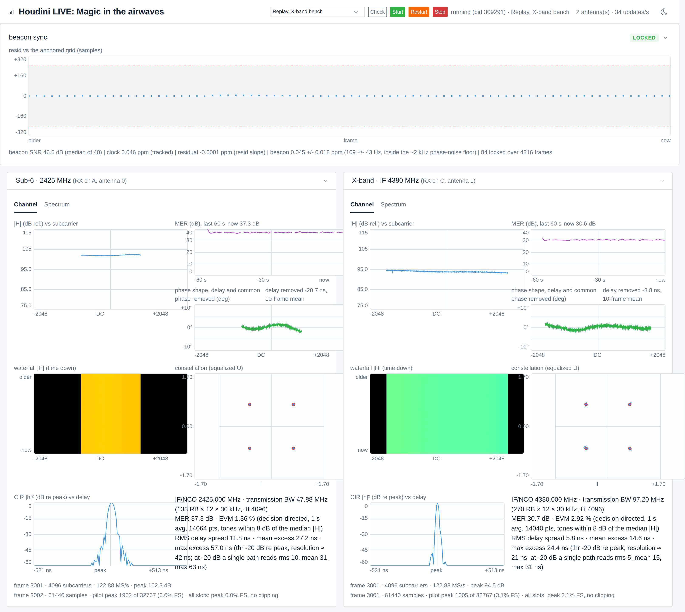
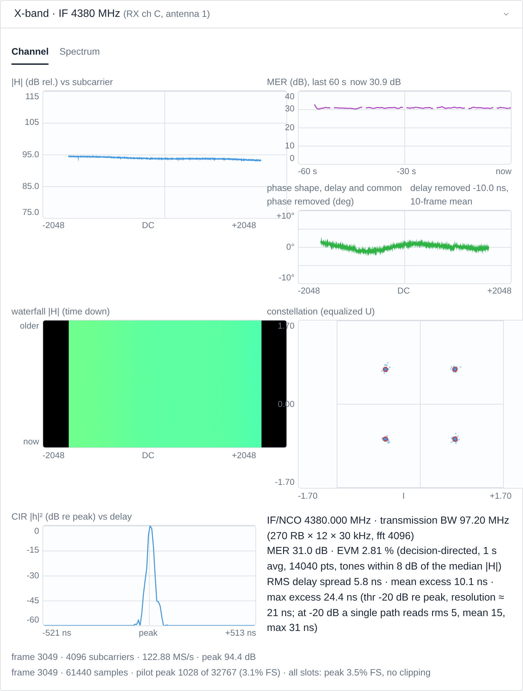
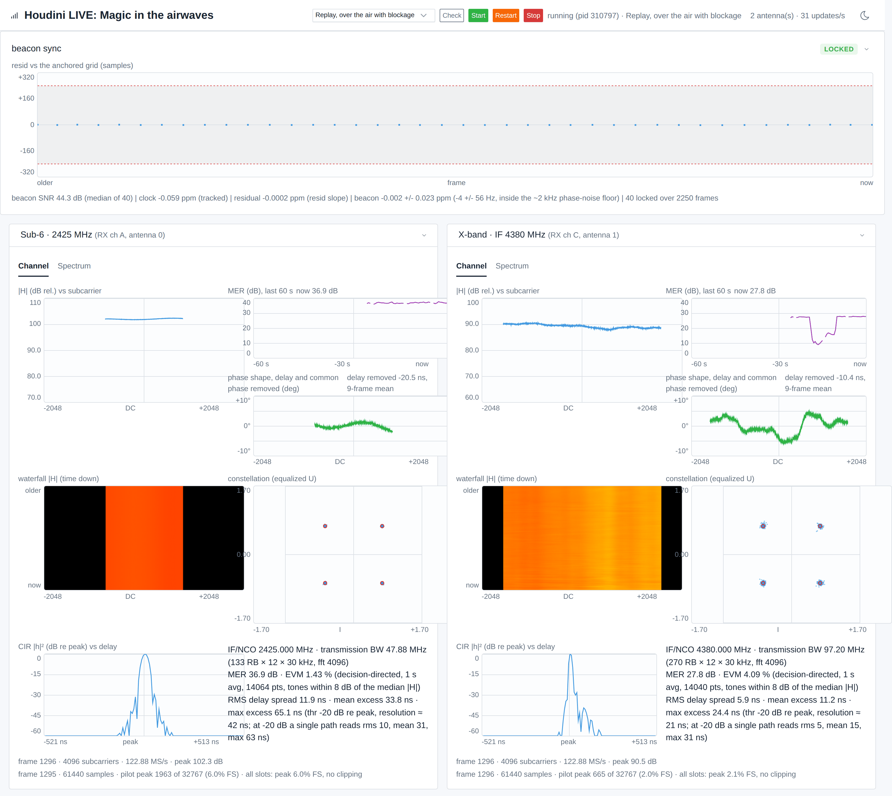
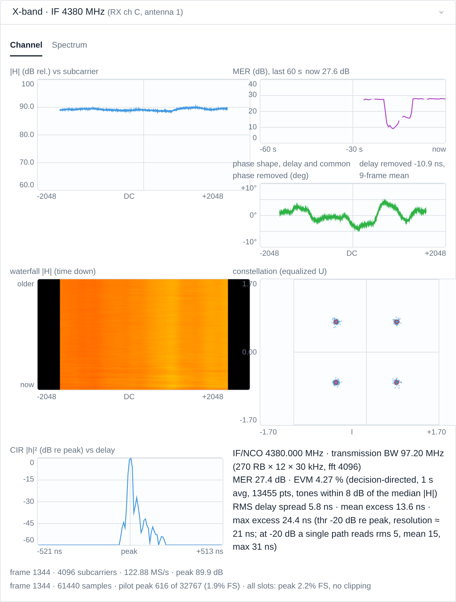
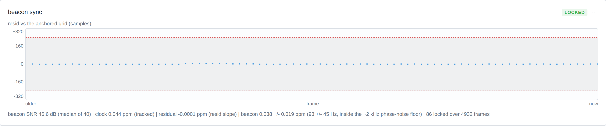
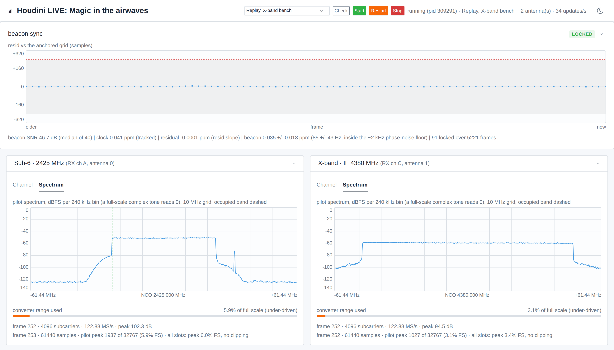

# Reading the dashboard

What every panel of the live page shows, what healthy looks like and what a change means. This is the depth behind section 5 of `CSI_DEMO_WALKTHROUGH.md`, kept apart so the run path stays short; section 6 of the walkthrough is the log-side check of the same run.

## 1. The page and its cards

Opening the page is the walkthrough's section 5. The page serves three routes: `/` is the dashboard itself, `/stream` is the
Server Sent Events feed it reads, and `/vendor/tabler.min.css` is the
stylesheet. You will not normally open the last two by hand.

The button at the top right switches between the dark and light theme. Your
choice is stored in the browser, so it survives a reload and a restart of the
backend. It is the same control, and the same two themes, as the RayNet
compiler dashboard.

The cards fill the width of the window and reflow as you resize it, so a wider
window gives you more cards side by side rather than more empty space. The panels
inside a card stretch with it, so making the window wider makes every plot bigger.

The whole page on the "Replay, X-band bench" recording (a recording of the
dashboard's input played back through the page with no radios, `CSI_DEMO_WALKTHROUGH.md` section 4.4),
light theme: the beacon sync card, LOCKED, above the two antenna cards on
their Channel tab. Every panel shows real bench data.

With `--control` the header carries the config list (shown expanded here),
the demo configs by their labels and the replays after them, then the
buttons and the state line naming what runs.

Each receive antenna gets one card. Once the sounder's channel metadata
arrives the card is titled by its band, for example
`Sub-6 · 2425 MHz (RX ch 0, antenna 0)` or
`X-band · IF 4380 MHz (RX ch 2, antenna 1)`. Its **Channel** tab carries:

1. **\|H\| in dB** across subcarriers. This is the frequency response of the
   channel. Nulls are real multipath fades, not faults. The axis starts at the
   config's `dashboard_mag_top` (or `--mag-top`) and moves in 10 dB steps, at
   most once every 3 seconds, and only when the trace has left the axis or sat
   in its bottom quarter for that whole time; a steady trace never moves it.
   Between steps an `off scale` badge marks a trace outside the axis.
2. **MER over the last 60 seconds**, on a fixed 0 to 40 dB axis, from the
   card's one-second MER. It shows steering, fades and interference as they
   happen; a gap in the line is a stretch with no constellation.
3. **Phase shape** in degrees, on a fixed plus or minus 10 degree axis: each
   frame's phase with its measured delay (a straight line across the band) and
   its common phase removed, averaged over half a second. The removed delay is
   printed beside the title. On a cable what remains is the filters' ripple.
4. **Waterfall of \|H\|**, time running downward. This is the panel that
   shows stability: a steady link draws smooth vertical streaks, and a link
   that keeps re-locking draws horizontal tearing.
5. **Constellation**, equalized uplink data. Only populated when the frame
   carries an uplink data slot (`U` in the schedule). Clean QPSK shows four
   tight clusters.
6. **CIR**, the impulse response of the same H: dB relative to the strongest
   tap on a fixed 0 to -60 dB axis, delay in ns from that tap. A clean cable
   reads as one mainlobe about 2/B wide (the Hann window), not a single tap.

Under the panels the quality line gives the lane's IF (NCO) and transmission
bandwidth (in resource blocks when the tones make whole NR resource blocks),
the MER and EVM (decision directed, averaged over about a second, over the
tones within 8 dB of the median \|H\|), and the delay spread figures with
their threshold and resolution. The point count beside the MER steps between
two values (for example 13,478 and 14,064): each constellation record carries a
fixed number of points, and the one-second window holds one record more or less
depending on when it closes. That is the averaging, not lost data.

The X-band card on the same replay, up close: the six panels in the order
above and the quality line under them, a flat |H| across 97 MHz, a steady MER
near 31 dB, four tight QPSK clusters and a single-mainlobe CIR.

Guard band and DC null subcarriers are drawn as gaps in every per-subcarrier
panel, never as zeros: nothing is transmitted there, so nothing is measured
there. Expect gaps at the band edges and one at DC.

What a fade looks like: the "Replay, over the air with blockage" recording
has the X-band path blocked by hand for about nine seconds. The MER panel
shows the dip to about 10 dB and the recovery, the waterfall shows the same
seconds as a darker band, and the sub-6 card, on its own cable, does not move.

The page at the moment the X-band MER trace and waterfall show the dip and
the recovery.

The X-band card up close at the same moment: the MER trace, the darker band
on the waterfall and the wider constellation are the one event.

## 2. When a card dims

If an antenna stops producing updates, its plots dim and a `stale 2.3 s` badge
appears next to the antenna name, counting up until fresh data arrives. The
card then returns to normal on its own.

This matters because the sounder refuses slots whose samples carry receive gaps
(`TROUBLESHOOTING.md` section 4), so a losing link stops sending rather than sending something
untrue. Without the badge, the panels would simply hold their last good values,
and on a stationary bench a frozen display and a healthy static channel look
exactly the same. A dim card means "this is the last thing we knew, not what is
happening now".

The threshold is 1.5 seconds by default. If you lower `--csi-fps`, raise it to
match with `--stale-ms`, or every card will read as stale.

`--stale-ms` sets the refresh floor for BOTH card types. The sync card decides
what to display using its own thresholds, but its age can only advance when the
server pushes an event, and that decision uses `--stale-ms`. So raising it
delays how quickly the sync card notices a quiet link too (section 3).

## 3. The beacon sync card

One card per client, above the antenna cards. It answers a different question
from the channel panels: not "what does the channel look like" but "is the UE
still locked to the base station's beacon, and how far off is it".

The trace is `resid`: how many samples the detected beacon landed from where the
anchored grid predicted it. The shaded band is the acceptance tolerance the
sounder actually applies, carried on the wire rather than hardcoded in the page,
so it always matches the running code. Healthy looks like a flat line on zero
well inside the band.

The x axis is the FRAME NUMBER, not the point index. Detections are irregularly
spaced, and a wide gap is itself information, so an evenly spaced axis would
hide it.

The badge reads one of:

| Badge | Meaning |
|---|---|
| `LOCKED` | Beacon found where the anchored grid predicted it. Normal. The UE still nudges its schedule on one of these, by a fraction of the measured residual, so a locked run is a tracking run and not a frozen one. |
| `HOLD PENDING` | One off-grid detection seen. Deliberately NOT acted on: single large offsets are scatter, so the sounder waits for a second consistent one. |
| `RE-ANCHORED` | The UE gave up tracking and re-acquired. The readout names the schedule step applied. This is the LARGE move; the small per detection nudge on a `LOCKED` record is the other one. |
| `WEAK BEACON` | Something was detected but it failed the SNR floor. Different from no beacon at all, and usually means levels or cabling. |
| `RE-ANCHOR FAILED` | An escalation ran and re-acquisition did not confirm. The previous anchor is being kept. |
| `NOT SYNCED` | No detections at all, or the stream has been silent for a minute. |

A badge may be suffixed `quiet 4.2s`. That is NOT a fault. The UE reports only
when it makes a detection, and it only attempts one when the anchored grid
predicts the beacon inside the read window, so seconds of silence between bursts
are normal on a perfectly healthy link. The plot dims while quiet so you can see
at a glance that you are looking at held data rather than live data.

How long is normal depends on the cadence. The client looks at the beacon only
as often as its tracked clock needs (seconds apart on a steady link;
`sync.resync.residual_ppm` and `sync.resync.sync_tol_samples` set it, `SOUNDER_REFERENCE.md` section 4), so a healthy link is quiet most of the time, and the badge only means
something if it is much longer than the cadence. The page works this out for
itself: it measures the interval between the reports it actually receives and
marks the card quiet at three times that, so the badge keeps its meaning
whatever the cadence. Nothing to configure.

The sync card on the bench replay: every detection on zero, well inside the
band, and the readout line described next.

The readout line carries three figures in ppm, and they are not three views of
one number. Read them in this order.

1. **clock** is the total offset the client's timing tracker currently holds. It
   comes from the frame period the tracker has learned, and on a two board bench
   running on internal references it reads several ppm. It is a filtered state
   rather than a set of samples, so it is printed as a value with no error bar.
2. **residual** is what is left after the tracker has done its work, fitted from
   the slope of the resid trace. It should sit near zero. This is the number that
   tells you the loop is closed.
3. **beacon** is a separate instrument. It measures the same total offset from
   the beacon's own carrier phase, independently of the timing channel, and it
   carries a standard error because each detection is an independent reading.

The cross check that means something is **clock against beacon**, because those
two measure the same quantity two different ways. Do not compare clock against
residual: residual is clock's own error term, so the two are meant to differ by
whatever factor the tracker is winning by, and a large ratio there is the loop
working rather than a fault.

Expect the beacon figure to sit off the clock figure by a fixed amount on any
given bench. The beacon estimator is precise but carries a configuration
dependent bias, so treat it as a liveness and sanity instrument rather than the
value to correct with. It is annotated when it falls inside the phase noise
floor: a short correlation lag turns a tiny phase error into an apparently large
frequency, so treat sub kilohertz beacon readings as instrument noise rather
than a real offset. It reads `beacon n/a` when the visible segment holds no
detection to estimate from.

## 4. The Spectrum tab

Each card has two tabs. **Channel** is everything above. **Spectrum** shows
the received pilot slot in frequency and how much of the converter it uses,
which is where you look when the channel panels are strange and you suspect
the front end rather than the algorithm.

Both cards on the Spectrum tab, on the bench replay: a flat shelf between the
dashed band edges on each, the floor well below it, and the converter range
bar under each (both under-driven here, as the bar's colour says).

The trace is the pilot slot's **spectrum in dBFS per bin** (the bin width is
in the panel title) on a fixed 0 to -140 dB axis, so a full-scale complex tone
reads 0 dBFS and a level change is a real change, not a rescale. The x axis is
MHz from the lane's NCO on a 10 MHz grid, and two dashed lines mark the
occupied band's edges. A healthy pilot is a flat shelf between the dashed
lines with the floor well below it outside; a spur, an image or a filter edge
shows up where it sits. A value above the top pins to it and lights an
`off scale` badge.

The absolute question, how much of the converter you are using, is answered
underneath by a bar on a fixed full scale. The bar turns amber below 10
percent, meaning under driven, and red at 95 percent or on any clipped
sample. The status line reports the pilot peak in counts and as a percent of
full scale, plus the peak and clipped count across every slot of the frame,
not just the plotted one. A `clipping` badge appears next to the title when
the clipped count is not zero.

Aim for a peak somewhere around half to three quarters of full scale. Much
lower wastes converter bits and the constellation gets noisy. At the rail
the samples are simply wrong and every panel downstream inherits it.

One caveat to know before you trust a reading of zero clipped samples. Full
scale here means the rail of the 16 bit sample format the sounder uses
throughout. If the converter ever delivers a narrower sample that is not
shifted up into the top of those 16 bits, the true rail is lower, the
clipped count stays at zero, and the peak reads as though there were
headroom. The tell is the peak itself: a peak that reports the same value on
every frame is the rail, whatever number it shows.

The tabs are per card, so you can watch one antenna's converter while
another shows its channel. That is how you find the single antenna that is
clipping.
